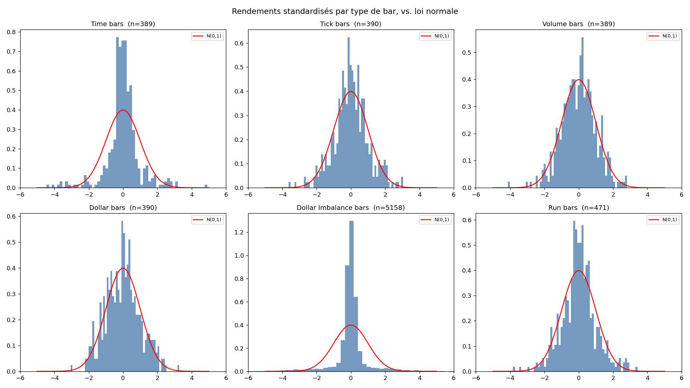

# Financial Data Structures: Alternative Bars from Tick Data

> Why sample markets by **clock time** when information arrives at an irregular pace? This project rebuilds six bar types from raw trades (time, tick, volume, dollar, dollar-imbalance, run) and **measures statistically which one produces the best-behaved returns**.

  



---

## TL;DR for recruiters

| | |
|---|---|
| **Problem** | Time bars oversample quiet periods and undersample busy ones. Their returns are fat-tailed and heteroskedastic, which breaks many ML and statistical models. |
| **Solution** | Build activity-driven bars from tick/trade data and compare their statistical properties with a battery of tests. |
| **Headline result** | On the simulated dataset, **dollar bars gave returns closest to Gaussian** (Jarque-Bera 1.5 vs 447.3 for time bars). |
| **Skills shown** | Market microstructure, time-series statistics, data engineering on large tick datasets, reproducible analysis, honest reporting of limitations. |

---

## Bar types implemented

| Bar | Sampling rule |
|---|---|
| **Time** | A new bar every fixed time interval (the usual baseline). |
| **Tick** | A new bar every N trades. |
| **Volume** | A new bar every N units traded. |
| **Dollar** | A new bar every N units of traded value (price × volume). |
| **Dollar imbalance** | A new bar when the cumulative *signed* dollar flow becomes unusually one-sided. |
| **Run** | A new bar when a run of same-side trades becomes unusually long. |

Imbalance and run bars sample on **information content** (order-flow asymmetry) rather than on a fixed quantity.

---

## Pipeline

```
data_acquisition.py / data_acquisition_mt5.py   Tick & trade data (generic source and MetaTrader 5)
comparison_synthetic_mt5.py                     Synthetic vs MT5 data comparison
bars.py                                         Time, tick, volume, dollar bars
imbalance_bars.py                               Imbalance and run bars
statistical_tests.py                            JB, Ljung-Box, ARCH, ADF tests
run_analysis.py                                 Runs everything, writes CSV + plots
GUIDE.md                                        Step-by-step walkthrough
RESULTS.md                                      Full results tables
```

Outputs: `bars_comparison_results.csv`, `bar_size_distribution.png`, `return_distributions.png`, `acf_comparison.png`, `jb_and_kurtosis.png`.

---

## Statistical tests used

| Test | Question it answers |
|---|---|
| **Jarque-Bera**, skewness, excess kurtosis | Are returns close to a normal distribution? |
| **Ljung-Box** (lag 1) | Is there remaining autocorrelation? |
| **ARCH** | Is there volatility clustering (heteroskedasticity)? |
| **ADF** | Are returns stationary? |

---

## Results

Dataset: **261,323 simulated trades over 5 days**.

### Bar counts and size

| Bar type | # bars | Avg trades/bar | Std of size |
|---|---|---|---|
| time | 390 | 670.1 | 645.0 |
| tick | 391 | 668.3 | 32.7 |
| volume | 390 | 670.1 | 290.3 |
| dollar | 391 | 668.3 | 321.5 |
| dollar_imbalance | 5,159 | 50.7 | 76.1 |
| run | 472 | 553.7 | 54.7 |

### Statistical properties of returns

| Bar type | JB stat | Skew | Excess kurtosis | ARCH p-val | ADF p-val |
|---|---|---|---|---|---|
| time | 447.3 | -0.372 | 5.200 | 0.0000 | 0.0000 |
| tick | 10.4 | -0.039 | 0.797 | 0.0016 | 0.0000 |
| volume | 8.2 | -0.154 | 0.640 | 0.4885 | 0.0000 |
| dollar | **1.5** | 0.147 | -0.081 | 0.0727 | 0.0000 |
| dollar_imbalance | 32,625.7 | 0.169 | 12.316 | 0.0000 | 0.0000 |
| run | 25.4 | 0.049 | 1.134 | 0.0011 | 0.0000 |

(Ljung-Box lag-1 p-values are in `RESULTS.md`.)

### Key takeaways

1. **Time bars are the least Gaussian of the regular bars**: excess kurtosis of 5.2 and strong volatility clustering.
2. **Tick, volume and dollar bars cut the JB statistic by one to two orders of magnitude.** Volume bars (ARCH p = 0.49) and dollar bars (ARCH p = 0.07) show no significant volatility clustering at the 5% level.
3. **Dollar-imbalance bars are the most extreme**: they produce about 13× more bars (5,159) and the heaviest tails (excess kurtosis 12.3). They are built to detect informed flow, not to look Gaussian.
4. All return series are stationary according to ADF.

### Limitations

- The dataset is **simulated**, so these results show the methodology working, not a claim about real markets. The MT5 acquisition script is there to repeat the study on real ticks.
- Ljung-Box shows remaining lag-1 autocorrelation for every bar type, which deserves investigation on real data.

---

## Quick start

```bash
pip install -r requirements.txt
python run_analysis.py
```

See `GUIDE.md` for the detailed walkthrough.

---

## Skills demonstrated

**Quant / statistics**: market microstructure, order-flow imbalance, normality, autocorrelation, ARCH and stationarity testing
**Python**: pandas, NumPy, statsmodels/SciPy-style testing, Matplotlib, large-dataset processing
**Research practice**: controlled comparison, reproducible outputs (CSV + plots), explicit limitations

---

## Author

**Thanh Son Potherat**: engineering student focused on quantitative finance, machine learning and data science.
[GitHub](https://github.com/Thanh-Poth) | [LinkedIn](https://www.linkedin.com/in/thanh-son-potherat-b793b333a/)
